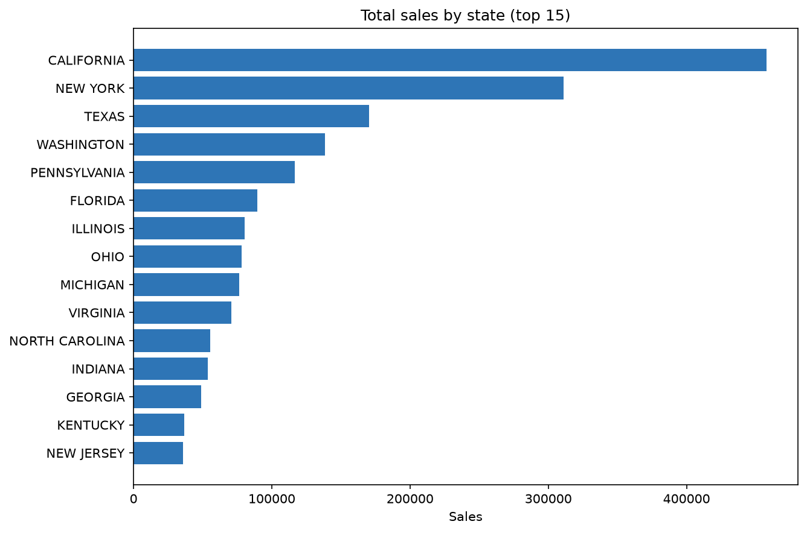
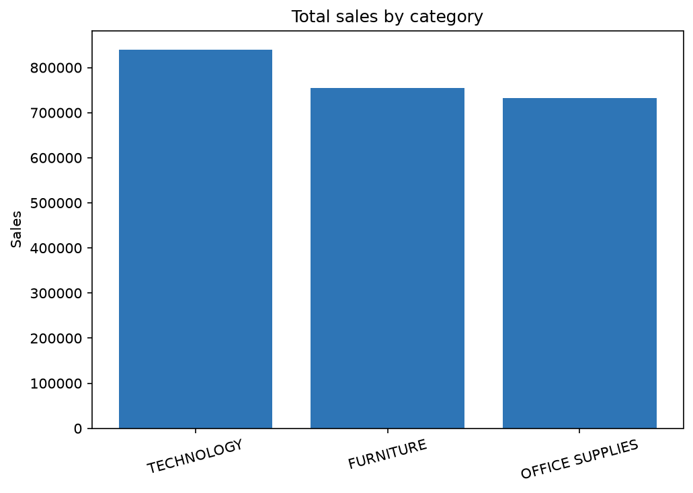
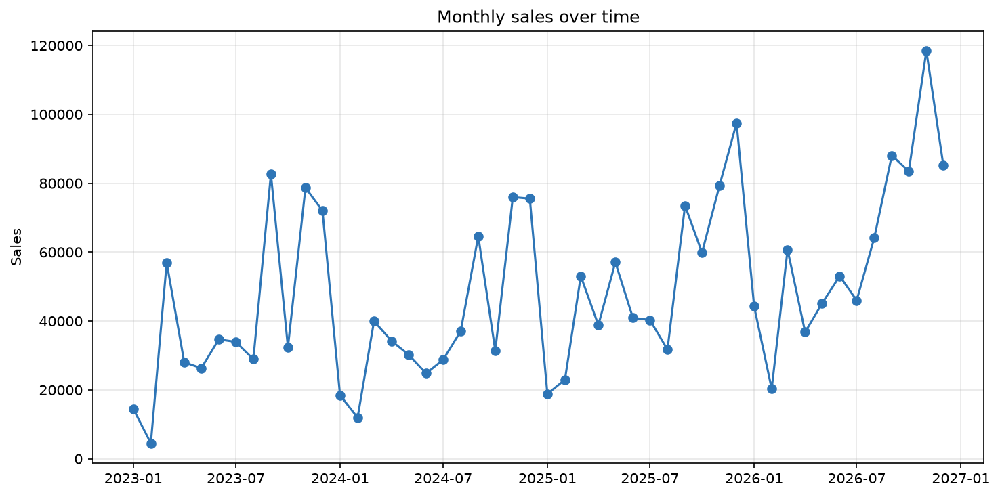
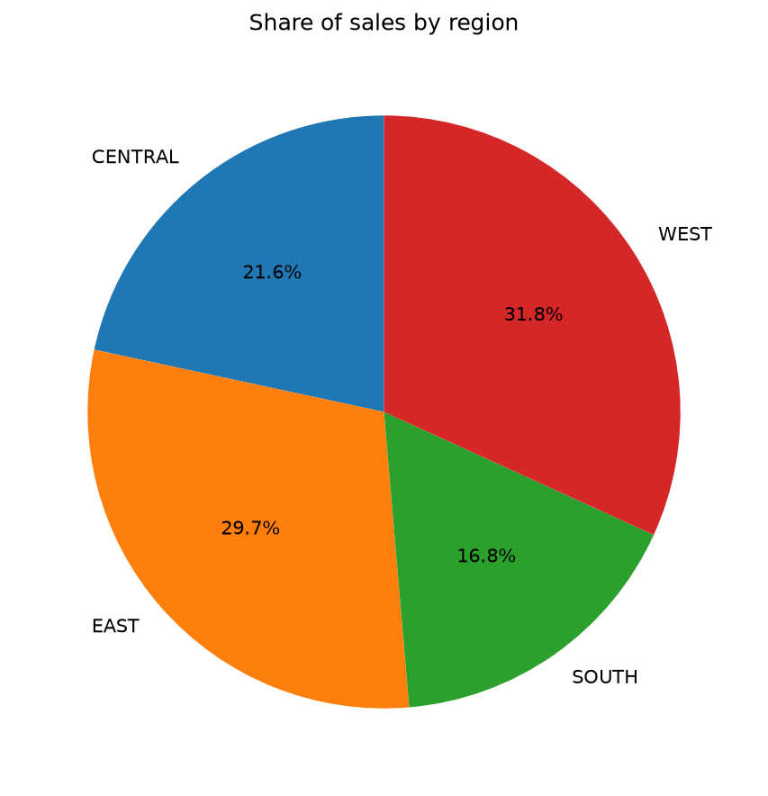
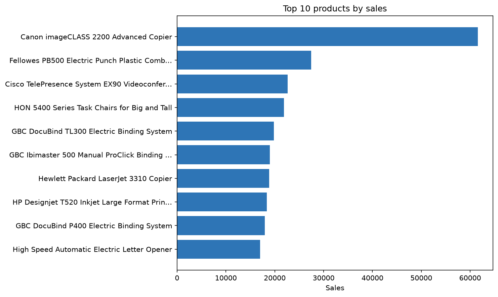
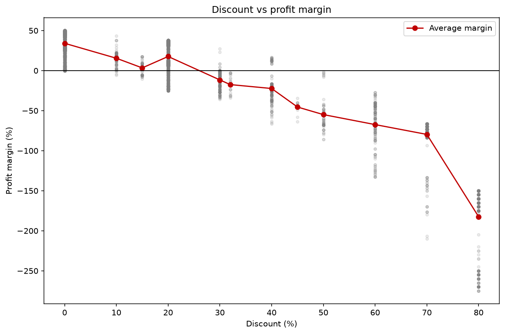

# Superstore: Sales Performance Analysis and Reporting System

**Course:** CSQ242 Work Integrated Training-I, Project 2
**Name:** Tulip Sharma **Registration No.:** 12504985
**Tools:** Python 3.12, SQLite, pandas, matplotlib

---

## 1. Objective and approach

Three separate files (Orders, Returns, People) describe a retail company's orders, returned orders and sales representatives. The task was to integrate and clean them, then analyse sales, profitability and returns.

The work is split deliberately in two:

- **SQL (SQLite)** is where the data is made trustworthy: typed loading, date conversion, de-duplication, text standardisation, joins and derived columns.
- **pandas** is where the cleaned result is interrogated: metrics, rankings, geography, returns, shipping and discounts.
- **matplotlib** draws the charts. Every plotted number is computed by the analysis code.

Pipeline (each script is run from the project root, in order):

| Script | Purpose |
|---|---|
| `src/01_load.py` | Load the three CSVs into typed SQLite tables |
| `src/02_profile.py` | Profile nulls, duplicates and baseline statistics before any change |
| `sql/03_clean.sql`, `src/03_run_clean.py` | Clean, join and derive columns in SQL |
| `src/04_transfer.py` | Move the cleaned table into pandas and verify it |
| `src/05_analysis.py` | All analysis (results saved to `outputs/analysis_results.txt`) |
| `src/06_charts.py` | Six charts saved to `outputs/charts/` |

---

## 2. Data and loading

| File | Rows loaded | Columns |
|---|---|---|
| `orders.csv` | 10,194 | 21 (Row ID, Order ID, Order Date, Ship Date, Ship Mode, Customer ID/Name, Segment, Country/Region, City, State/Province, Postal Code, Region, Product ID, Category, Sub-Category, Product Name, Sales, Quantity, Discount, Profit) |
| `returns.csv` | 296 | 2 (Order ID, Returned) |
| `people.csv` | 4 | 2 (Regional Manager, Region) |

**Typed loading.** The `orders_raw` table declares `INTEGER` for Row ID and Quantity, `REAL` for Sales, Discount and Profit, and `TEXT` for identifiers and descriptive fields. Numeric columns were not loaded as text and fixed later. Empty strings are converted to real `NULL` values rather than fake numbers.

**Dates are kept as raw text at load time** (`order_date_raw`, `ship_date_raw`) and converted inside SQL, because the brief requires date handling to be done in the SQL engine.

**Postal codes** are stored as text and left-padded to five digits. In the source file they had lost their leading zeros (the values have 3, 4 or 5 digits). Treating them as numbers would have corrupted them.

**Encoding.** The files are UTF-8 with a byte-order mark (exported from Excel), so they are read with `utf-8-sig`.

---

## 3. Missing-value report (before any change)

`src/02_profile.py` counted nulls in every column of every table before any cleaning.

| Table | Columns checked | Columns with nulls |
|---|---|---|
| `orders_raw` | 21 | **0** |
| `returns_raw` | 2 | **0** |
| `people_raw` | 2 | **0** |

**Decision: no imputation was performed.** With no missing values there is nothing to impute, so there is also no before-and-after distribution to compare. Inventing an imputation step would only fabricate work and risk altering good data. For the same reason, the optional model-based (KNN/regression) imputation does not apply.

Baseline statistics (minimum, mean, maximum) for Sales, Quantity, Discount and Profit were recorded from `02_profile.py` before cleaning, so the cleaned table can be compared against them.

---

## 4. SQL cleaning and preparation

Every step lives in `sql/03_clean.sql`, one intermediate table per step.

| Step | Table created | What it does | Why |
|---|---|---|---|
| 1 | `orders_dates` | Converts `DD-MM-YYYY` text into ISO dates (`YYYY-MM-DD`) using `substr` | The raw dates are text, which cannot be compared or subtracted. The format is unambiguous: the first component reaches 31 and the second never exceeds 12, so it is day-month-year. All values are 10 characters long, so fixed positions are safe |
| 2 | `orders_dedup` | Removes duplicate line items with `ROW_NUMBER() OVER (PARTITION BY order_id, product_id, quantity ORDER BY row_id)`, keeping row 1 | The brief defines a unique line item as Order ID + Product ID + Quantity. Keeping the lowest Row ID makes the choice deterministic |
| 3 | `orders_std` | `UPPER(TRIM(...))` on Segment, City, State, Region, Category, Sub-Category and Ship Mode | Case and stray whitespace would split one group into several in every `GROUP BY`. Names (customer, product) keep their original case for readability |
| 4 | `orders_clean` | LEFT JOINs to Returns and People, plus derived columns | See below |

### 4.1 Duplicates

| Table | Result |
|---|---|
| Orders | **2** duplicate line items found on (Order ID, Product ID, Quantity); removed, leaving **10,192** rows |
| Returns | **0** duplicate Order IDs |
| People | **0** regions with more than one representative, so no region has two owners |

### 4.2 Ship Mode decision

The brief mentions a `ShipModeCorrected` column to compare against `Ship Mode`. The supplied `orders.csv` has **no** `ShipModeCorrected` column, so there is nothing to reconcile. `Ship Mode` is the only source and is carried forward, standardised with `UPPER(TRIM())`. Its four values are First Class, Same Day, Second Class and Standard Class.

### 4.3 Joins

- **Orders to Returns (LEFT JOIN on Order ID).** The Returns file lists only returned orders (every row says `Yes`). A `CASE` expression creates `is_returned` (1 or 0). The LEFT JOIN keeps every order, so never-returned orders get 0 instead of disappearing. Result: **800 line items** across **296 orders** are flagged. All 296 returned Order IDs exist in Orders.
- The flag is **order-level**: every line item in a returned order has `is_returned = 1`. Return rates in this report therefore count distinct orders.
- **Orders to People (LEFT JOIN on Region).** The four regions each have exactly one representative (Chuck Magee, East; Fred Suzuki, South; Roxanne Rodriguez, Central; Sadie Pawthorne, West). **No row ended up without a representative.** The LEFT JOIN would have kept any unmatched row with a null person rather than dropping it.

### 4.3.1 Derived columns

| Column | Definition | Guard |
|---|---|---|
| `order_year`, `order_month`, `order_quarter` | From `order_date` via `strftime` | None needed |
| `unit_price` | `sales / quantity` | `NULL` when quantity is 0 or null |
| `profit_margin` | `profit / sales` | `NULL` when sales is 0 or null |
| `shipping_duration` | Days between `order_date` and `ship_date` via `julianday` | None needed |

**Note on Sales.** In this dataset Sales is already the total value of the line item after discount. It is not a unit price, so it is never multiplied by Quantity anywhere in the analysis.

**Negative margins are legitimate** here (a discounted line can lose money), so they were not filtered out.

### 4.4 Scope note

`orders_clean` carries City, State, Region, Category, Sub-Category and the other analysis fields. Country and Postal Code were not carried forward because no required analysis uses them. The State/Province column also contains Canadian provinces; all of the top 15 states by sales are US states.

---

## 5. SQL to pandas transfer and verification

The cleaned `orders_clean` table was queried into a pandas DataFrame (`parse_dates` on both date columns). Before any analysis, `src/04_transfer.py` compared pandas against SQL and asserted that they match:

| Check | pandas | SQL |
|---|---|---|
| Row count | 10,192 | 10,192 |
| Total sales | 2,326,153.86 | 2,326,153.86 |
| Total profit | 292,273.46 | 292,273.46 |
| Total quantity | 38,644 | 38,644 |
| Returned line items | 800 | 800 |
| Null counts | none | n/a |

All assertions passed (`All checks passed.`). The column types arrived as expected: dates as `datetime64`, numeric columns as `int64`/`float64`, text as strings.

---

## 6. Analysis results

All figures below come from `outputs/analysis_results.txt`.

### 6.1 Overall sales performance

| Metric | Value |
|---|---|
| Total sales | 2,326,153.86 |
| Total quantity sold | 38,644 |
| Total profit | 292,273.46 |
| Orders | 5,111 |
| Average sales per order (line items summed to order level first) | 455.13 |
| Overall profit margin | 12.6% |

By year, sales were 493,660 (2023), 472,993 (2024), 613,934 (2025) and 745,568 (2026): a small dip in 2024, then growth. Margins were 10.5%, 13.1%, 13.5% and 12.9%. About 18.6% of line items (1,900 of 10,192) lost money.

### 6.2 Top performers

- **Top products by sales:** Canon imageCLASS 2200 Advanced Copier (61,599.82), Fellowes PB500 Electric Punch Plastic Comb Binding Machine (27,453.38) and Cisco TelePresence System EX90 (22,638.48).
- **Top products by quantity:** Staples (234 units), Staple envelope (170) and Easy-staple paper (150). Volume leaders are cheap consumables, while revenue leaders are expensive equipment, so the two rankings barely overlap.
- **Top customers by sales:** Sean Miller, SM-20320 (25,043.05), Tamara Chand, TC-20980 (19,052.22) and Raymond Buch, RB-19360 (15,117.34).

### 6.3 Geography

| State | Sales | Profit |
|---|---|---|
| California | 457,687.63 | 76,381.39 |
| New York | 310,876.27 | 74,038.55 |
| Texas | 170,188.05 | **-25,729.36** |
| Washington | 138,641.27 | 33,402.65 |
| Pennsylvania | 116,511.91 | **-15,559.96** |

By region: West 739,813.61 sales / 110,798.82 profit; East 691,447.68 / 94,859.90; Central 503,170.67 / 39,865.31; South 391,721.91 / 46,749.43. By city, New York City (256,368.16 sales, 62,036.98 profit) and Los Angeles (175,851.34, 30,440.76) lead.

**High sales with negative profit.** Ten states have above-median sales but a negative total profit: Texas, Pennsylvania, Florida, Illinois, Ohio, North Carolina, Arizona, Colorado, Tennessee and Oregon. Cities showing the same pattern include Philadelphia (109,077.01 sales, -13,837.77 profit), Houston (-10,153.55), Chicago (-6,654.57) and Jacksonville (-2,323.84).

**What drives it: discounting.** In those ten states the average discount per line item is **0.34**, against **0.16** across the whole dataset (a simple average of line-item discounts, not weighted by sales). Their biggest losses are in Binders (-38,510.50), Machines (-29,555.35) and Tables (-24,976.93). The pattern fits heavy discounting on a few product lines, which section 6.8 quantifies.

### 6.4 Category and sub-category

| Category | Sales | Quantity | Profit | Margin |
|---|---|---|---|---|
| Technology | 839,893.28 | 7,017 | 146,543.38 | 17.4% |
| Furniture | 754,367.27 | 8,359 | 19,706.64 | **2.6%** |
| Office Supplies | 731,893.31 | 23,268 | 126,023.44 | 17.2% |

Furniture has almost the same sales as the other categories but barely any profit. The cause is in the sub-categories: Tables lose money overall (profit -17,753.21 on 208,020.18 sales, margin -8.5%), as do Bookcases (-3,632.07) and Supplies (-1,171.39). The largest sub-categories by sales are Chairs (335,486.88), Phones (331,842.64) and Storage (224,644.55). Binders and Paper lead on quantity (6,071 and 5,207 units). Copiers have the highest margin at 37.2%.

### 6.5 Sales representatives

| Representative | Region | Sales | Profit | Margin |
|---|---|---|---|---|
| Sadie Pawthorne | West | 739,813.61 | 110,798.82 | 15.0% |
| Chuck Magee | East | 691,447.68 | 94,859.90 | 13.7% |
| Roxanne Rodriguez | Central | 503,170.67 | 39,865.31 | **7.9%** |
| Fred Suzuki | South | 391,721.91 | 46,749.43 | 11.9% |

Roxanne Rodriguez (Central) has the lowest margin, so her region is the one most worth reviewing for discounting.

**Category strengths.** Technology is the top-selling category for Chuck Magee (267,938.07), Roxanne Rodriguez (170,416.31) and Fred Suzuki (148,771.91). Sadie Pawthorne's best category is Furniture (260,679.73), narrowly ahead of Technology (252,766.99). By quantity, Office Supplies leads for all four representatives.

### 6.6 Returns

- **296 of 5,111 orders were returned: a return rate of about 5.8%.**
- By category (distinct orders containing the category; one order can span several categories, so these counts overlap): Technology 7.9% (123 of 1,560), Furniture 7.5% (136 of 1,819), Office Supplies 6.1% (234 of 3,812).
- Highest-return sub-categories: Machines 11.4% (13 of 114), Tables 9.6% (30 of 314), Appliances 8.7% (40 of 459) and Phones 8.6% (71 of 826).

### 6.7 Regional performance and segment mix

| Region | Consumer | Corporate | Home Office | Orders |
|---|---|---|---|---|
| Central | 51.6% | 29.5% | 18.9% | 1,179 |
| East | 50.2% | 31.7% | 18.0% | 1,475 |
| South | 54.0% | 30.1% | 15.9% | 822 |
| West | 51.1% | 29.9% | 19.0% | 1,635 |
| **Overall** | **51.4%** | **30.4%** | **18.2%** | 5,111 |

(Segments are counted once per order.) **No region's segment mix differs sharply from the overall mix.** The largest gaps are South, with 2.6 points more Consumer and 2.3 points fewer Home Office orders, and East, with 1.4 points more Corporate. Segment mix therefore does not explain the regional profit differences.

### 6.8 Product, shipping and discount analysis

**Product metrics.** For each Product ID the analysis computes total sales, quantity, profit, number of orders containing the product, returned orders, return rate, adjusted profit (profit x (1 - return rate)) and adjusted margin.

**Underperforming products.** To avoid noise from products with very few orders, only products with at least 10 orders were considered. A product is flagged if its return rate is in the top 10% or its adjusted margin is in the bottom 10% of that group. The weakest by adjusted margin are mostly Binders, Storage and Chairs, for example Avery Non-Stick Binders (-18% adjusted margin), SAFCO Commercial Wire Shelving, Black (-15%, adjusted profit -635.44), Global Wood Trimmed Manager's Task Chair, Khaki (-10%) and Global High-Back Leather Tilter, Burgundy (-8%). The 10-order cut-off and the 10% quantiles are my own choices; changing them would change the list.

**Shipping duration (days).**

| Ship mode | Mean | Median | Std dev |
|---|---|---|---|
| Same Day | 0.04 | 0 | 0.21 |
| First Class | 2.18 | 2 | 0.77 |
| Second Class | 3.24 | 3 | 1.19 |
| Standard Class | 4.99 | 5 | 1.01 |

| Region | Mean | Median | Std dev |
|---|---|---|---|
| Central | 4.05 | 4 | 1.69 |
| East | 3.91 | 4 | 1.72 |
| South | 3.96 | 4 | 1.74 |
| West | 3.94 | 4 | 1.80 |

**Bottleneck:** shipping speed depends on the ship mode, not the region. Regions are nearly identical (3.9 to 4.1 days). Standard Class is the slowest at about 5 days, and it carries 3,068 of the 5,111 orders (60%), so it is where delays would matter most.

**Return rate by ship mode and region.**

| Ship mode | Orders | Returned | Rate |
|---|---|---|---|
| First Class | 795 | 54 | 6.8% |
| Same Day | 266 | 19 | 7.1% |
| Second Class | 982 | 55 | 5.6% |
| Standard Class | 3,068 | 168 | 5.5% |

| Region | Orders | Returned | Rate |
|---|---|---|---|
| Central | 1,179 | 39 | 3.3% |
| East | 1,475 | 44 | 3.0% |
| South | 822 | 24 | 2.9% |
| **West** | 1,635 | **189** | **11.6%** |

Ship modes differ only modestly (5.5% to 7.1%). **The West region is the material outlier: its return rate is about four times that of every other region.** The Returns file records no reason for a return, so the data cannot say why. This is a finding to investigate, not an explanation.

**Sales, profit and margin by discount level.** Discounts were grouped into bands. Each band covers values above its lower bound up to and including its upper bound. The distinct discount values in the data are 0, 10, 15, 20, 30, 32, 40, 45, 50, 60, 70 and 80%. The band labelled "50%+" in the output therefore holds the 60 to 80% discounts, because a 50% discount falls in the 40-50% band.

| Discount band | Line items | Quantity | Sales | Profit | Margin |
|---|---|---|---|---|---|
| 0% | 4,924 | 18,762 | 1,105,224.67 | 326,683.17 | 29.6% |
| 0-10% | 96 | 377 | 54,952.50 | 9,099.97 | 16.6% |
| 10-20% | 3,758 | 14,054 | 801,497.92 | 92,498.94 | 11.5% |
| 20-30% | 229 | 853 | 104,192.69 | -10,501.39 | **-10.1%** |
| 30-40% | 234 | 894 | 130,991.22 | -25,477.51 | -19.4% |
| 40-50% | 77 | 286 | 64,403.51 | -22,999.54 | -35.7% |
| 50%+ (60-80%) | 874 | 3,418 | 64,891.35 | -77,030.19 | -118.7% |

---

## 7. Discount threshold conclusion

**Threshold: discounts above 20% destroy margin faster than they add volume.** Up to and including a 20% discount, profit margin stays positive (11.5% in the 10-20% band). Above 20%, every band is loss-making, and losses deepen with the discount: -10.1%, -19.4%, -35.7% and then -118.7%.

Evidence:

1. **Margin turns negative above 20%.** In the discount-vs-margin scatter plot (chart 6), the average margin line is positive at a 20% discount and negative at 30%, crossing zero between the two.
2. **Deeper discounts do not bring larger orders.** Average quantity per line item is almost flat across bands: about 3.8 at 0%, 3.7 at 10-20%, 3.7 at 20-30%, 3.8 at 30-40%, 3.7 at 40-50% and 3.9 above 50%. If heavier discounts were buying extra volume per sale, this figure would rise with the discount. It does not.
3. **The aggregate cost is large.** Line items discounted above 20% are 1,414 of 10,192 lines (13.9%) and 5,451 of 38,644 units (14.1%). They bring in 364,478.77 of sales but **lose 136,008.63 of profit**, which is nearly half the size of the 292,273.46 total profit.

**Limits of this conclusion.** This is observational data. It shows that high-discount lines were unprofitable and did not sell in larger quantities per line. It cannot prove what would have sold without the discount, because the data has no counterfactual. The threshold is also read from banded averages, not from individual products, since some products can absorb a deeper discount than others.

---

## 8. Charts

Charts are saved in `outputs/charts/`, and every plotted value is computed by the analysis code.

1. **Total sales by state (top 15):** California and New York lead by a wide margin.
   
2. **Total sales by category:** Technology, Furniture and Office Supplies are close in sales, which hides the very different margins in section 6.4.
   
3. **Monthly sales over time:** sales show a clear seasonal pattern on top of overall growth. Summed across all years, November (352,567), December (330,218) and September (308,884) are the largest months, while February (59,751) and January (96,070) are the smallest.
   
4. **Share of sales by region (pie):** West and East together account for about 62% of sales.
   
5. **Top 10 products by sales:** dominated by copiers, binding machines and office technology.
   
6. **Discount vs profit margin (scatter):** grey points are individual line items, the red line is the average margin at each discount value. It makes the threshold from section 7 visible.
   

---

## 9. Findings and implications

1. **Discounting is the main profit leak.** Lines discounted above 20% lose 136,008.63 and explain why high-sales states such as Texas, Pennsylvania and Ohio are unprofitable. Capping discounts at 20% is the clearest action the data supports.
2. **Furniture is weak because of Tables and Bookcases**, not because of the whole category.
3. **The West region has a return rate of 11.6%**, about four times the other regions, and warrants investigation. The cause cannot be determined from this data.
4. **Central (Roxanne Rodriguez) has the lowest margin** at 7.9%.
5. **Shipping speed is a function of ship mode, not region**, so regional delivery is not a bottleneck.

---

## 10. Limitations and assumptions

- **No missing values were found**, so no imputation was done and the optional model-based imputation was not applicable.
- **No `ShipModeCorrected` column exists** in the supplied data, so Ship Mode was used as is.
- **Return reasons are not recorded.** Return analysis shows where returns happen, not why.
- **The discount conclusion is correlational.** See section 7.
- **The sample dataset contains order dates through December 2026**, later than the date this analysis was produced, which indicates it is sample or synthetic data. It was analysed as given, and the 2026 totals include those dates.
- **Thresholds for underperforming products** (at least 10 orders, top/bottom 10%) are analyst choices.
- **Average discounts** in section 6.3 are simple averages over line items, not sales-weighted.
- **Return rates are order-level**, so an order with several lines counts once for each category or product it contains.